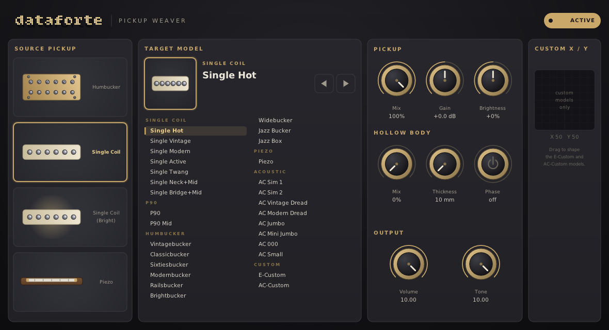

# Pickup Weaver — guitar pickup, hollow-body and tone-pot simulation

<p align="center"></p>

Pickup Weaver is a stereo LV2/VST2/VST3/CLAP plugin that turns one guitar
pickup into another: it models the pickup's electrical network (resonance,
load and cable capacitance), an acoustic/hollow-body stage, a passive tone
pot and the output stage. 29 factory pickups in four families (humbucker,
single coil, bright single coil, piezo) plus a two-axis **Custom** model,
with seamless morphing between the source and target pickups.

The DSP core is framework-neutral C++17 with SSE2 / AVX (runtime dispatch) /
NEON; the plugin wrapper is DPF, and the same cairo-free NanoVG painter
draws the desktop GUI and the modgui assets. The core is verified
bit-identically against the reference engine it was derived from (see
`dsp/README.md` and `plugin/README.md`).

## Controls

The 15 parameters use the reference plugin's ranges and plain units.

| Parameter | Range | Function |
|---|---|---|
| Pickup Enabled | on/off | engage the pickup model (squared 20 ms crossfade) |
| Pickup From | 4 families | source pickup family: Humbucker, Single Coil, Single Coil (Bright), Piezo |
| Pickup To | 29 models | target pickup (model list, ◀ ▶ or the drop-down) |
| Amount | 0–100 % | morph between the source and the target pickup |
| Custom X / Custom Y | 0–100 % | the two-axis custom pickup model |
| Body Enabled | on/off | engage the hollow-body stage |
| Body Thickness | 10–100 mm | body size / lowest mode |
| Body Amount | 0–100 % | body contribution |
| Body Phase | on/off | body polarity |
| Brightness | −100…+100 % | pickup/cable brightness (resonance and load) |
| Gain | −20…+20 dB | output gain |
| Volume | 0–10 | volume-pot position |
| Tone | 0–10 | tone-pot position |
| Bypass | on/off | DPF bypass (10 ms crossfade in the DSP) |

Continuous knobs smooth over a fixed 11.61 ms (the reference engine's
512-sample ramp); the pickup model glides over 20 ms and the enable/phase
switches crossfade over 20 ms, as measured on the reference.

## GUI

The desktop UI is a NanoVG vector interface (no raster assets, HiDPI and
user resizing, locked 1180×640 aspect): source tiles, the target model
display with pickup artwork, the model list, the seven main knobs and the
body/phase switches, plus the Custom X/Y pad. Knobs drag vertically (Shift
for fine), wheel steps, double-click resets; click-type changes are
bracketed with `editParameter` so hosts record them as automation.

The **modgui** for MOD Devices / MOD Desktop / Zynthian is pure HTML/CSS
inside the LV2 bundle (`modgui/`), with native `<select>` drop-downs for
the source and target pickups, seven knobs and a bypass footswitch; the
remaining parameters stay in MOD's settings panel, generated from the
plugin description. The knob sprites are rendered by the same painter as
the desktop GUI.

House rule: **editor-class UIs use NanoVG/DGL** (OpenGL); cairo is reserved for the pedal-face plugins.

## Building

```bash
git submodule update --init --recursive      # DPF (+ pugl); done by make
make                                         # -> plugin/build/bin/
make install INSTALL_DIR=~/.lv2
make install-all INSTALL_DIR=~/.lv2 VST2_DIR=~/.vst VST3_DIR=~/.vst3 CLAP_DIR=~/.clap
```

Prebuilt Linux x86_64 and arm64 archives are attached to the GitHub
releases (the release workflow builds them with CMake; the DPF Makefile
action is not used because this project uses CMake).

`make` configures and builds with CMake (Release), producing
`pickup_weaver.lv2` (DSP + UI + modgui), `pickup_weaver.vst3`,
`pickup_weaver.clap` and `pickup_weaver-vst2.so`. DPF is a submodule pinned
to the commit the plugin is tested with; the local VST3 fix in
`plugin/dpf-patches/` is applied idempotently at configure time, so the
submodule itself stays untouched. To build by hand:

```bash
cmake -S plugin -B plugin/build -DCMAKE_BUILD_TYPE=Release
cmake --build plugin/build -j
```

Release builds carry no absolute source paths (`-ffile-prefix-map`) and are
stripped. For a binary that runs on every x86-64 CPU build with
`-march=x86-64` (some distributions default to x86-64-v3); AVX is still
used at runtime when present. X11 + OpenGL development headers are needed
for the desktop UI; the LV2 DSP binary does not link X11, so it loads on
MOD hardware, and the modgui is pure web files.

## Testing

- `make test` builds everything and compares the plugin through CLAP and
  LV2 against the standalone core (`dsp/pw_cli`) for defaults, a complex
  static setting, bypass, dense automation of every parameter and
  model/switch changes, at block sizes 512 and 64: **bit-identical** in all
  renders (needs Python 3 with numpy and lilv).
- The core has its own suites in `dsp/`: `test_static.py` and
  `test_steps.py` against the reference captures, and
  `tests/test_simd.py` / `test_vmath.cpp` for bit-identity across backends.
- The reference verification also covers the Steinberg VST3 validator
  (537/537), Carla discovery of LV2/VST2/VST3, and headless GUI renders at
  1180×640, 2360×1280 and 590×320; see `plugin/README.md`.

## Layout

| path | contents |
|---|---|
| `data/` | pickup model table and custom-model navigator data (input of `dsp/gen_tables.py`) |
| `dsp/` | framework-neutral DSP core (header-only C++17 + SIMD); see `dsp/README.md` |
| `plugin/` | DPF wrapper, NanoVG GUI, modgui, tests and tools; see `plugin/README.md` |
| `dpf/` | DPF submodule (ISC) plus the local VST3 patch in `plugin/dpf-patches/` |

## Licence and credits

Pickup Weaver is **GPL-2.0-or-later** (see `LICENSE`). DPF and the four
plugin formats are permissive (DPF/LV2 ISC, VST2 BSD-3 via DPF's clean-room
headers, VST3 ISC, CLAP MIT) and keep their own notices; the embedded GUI
text is subsetted DejaVu (Bitstream Vera licence) and the dataforte wordmark
uses Bitcount Grid Double (SIL OFL 1.1, `plugin/assets/OFL-Bitcount.txt`).
